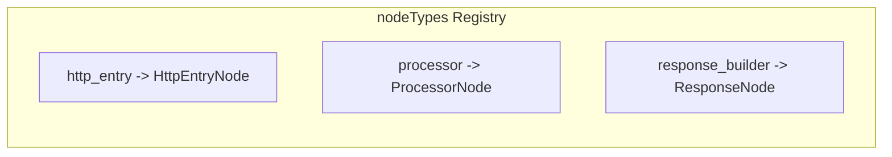
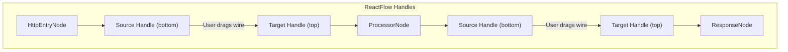
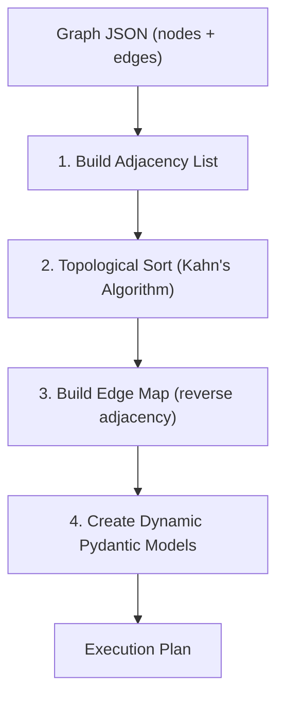
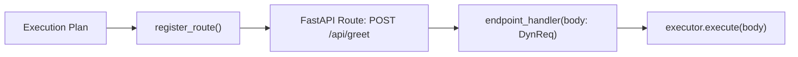
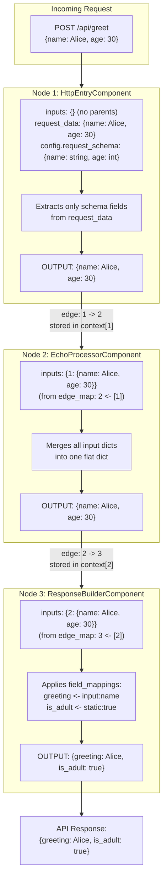
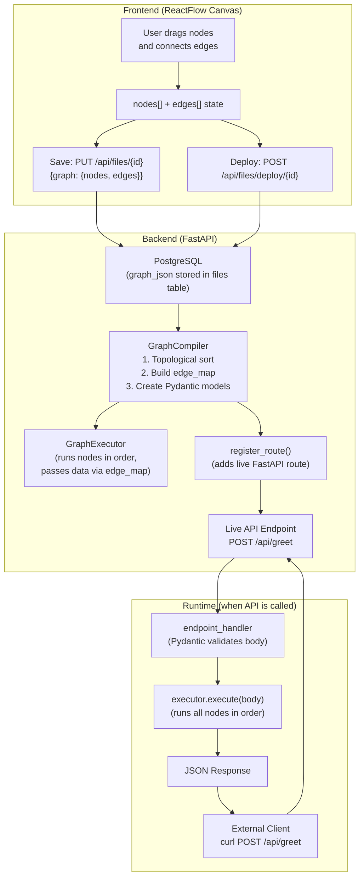

# SynthTeam: Nodes, Edges, and Data Flow -- Full Explanation

A comprehensive explanation of how SynthTeam's visual pipeline works end-to-end: from node/edge creation in the ReactFlow frontend, through graph serialization, backend compilation (topological sort + edge map), dynamic route registration, and runtime data flow across nodes via edges.

---

## Part 1: Frontend -- How Nodes and Edges Are Created

### Node Types

Three node types are registered in [`frontend/components/nodes/nodeTypes.ts`](../frontend/components/nodes/nodeTypes.ts):



Each node type maps a string key to a React component. ReactFlow uses this registry to render the correct UI when a node of that type exists on the canvas.

### How Nodes Are Added to the Canvas

When the user clicks a component in the sidebar palette ([`page.tsx` line 238-252](../frontend/app/files/[fileId]/page.tsx)), `addNode()` is called:

```typescript
const addNode = (type: string) => {
  setNodes((nds) => [
    ...nds,
    {
      id: `${Date.now()}`,         // unique timestamp ID
      type,                         // "http_entry" | "processor" | "response_builder"
      position: { x: 300, y: 150 }, // canvas coordinates
      data: getInitialConfig(type), // component name + default config
    },
  ]);
};
```

Each node's `data` object carries two critical fields:

- **`component`** -- the backend component name (e.g. `"http_entry"`, `"echo_processor"`, `"response_builder"`)
- **`config`** -- node-specific configuration that the user edits via the node UI

For example, an HttpEntryNode stores:

```json
{
  "component": "http_entry",
  "config": {
    "is_entry": true,
    "method": "POST",
    "path": "/api/hello",
    "request_schema": { "name": "string", "age": "int" },
    "response_schema": { "message": "string" }
  }
}
```

### How Edges Are Created (Connections Between Nodes)

Edges are created when the user **drags from a source Handle to a target Handle** on the canvas.



Each node type has specific handles:

| Node Type        | Target Handle (top) | Source Handle (bottom) |
|------------------|---------------------|------------------------|
| HttpEntryNode    | None (entry point)  | Yes (blue)             |
| ProcessorNode    | Yes (amber)         | Yes (amber)            |
| ResponseNode     | Yes (emerald)       | None (terminal)        |

When the user connects two handles, ReactFlow fires `onConnect` ([`page.tsx` line 255-269](../frontend/app/files/[fileId]/page.tsx)):

```typescript
const onConnect = (conn: Connection) => {
  setEdges((eds) =>
    addEdge({
      ...conn,     // { source: "node1_id", target: "node2_id" }
      animated: true,
      style: { stroke: "#6366f1", strokeWidth: 2 },
    }, eds)
  );
};
```

An edge object looks like:

```json
{ "source": "1700000001", "target": "1700000002", "animated": true }
```

The `source` and `target` are **node IDs**. This is the critical relationship -- it defines the **data flow direction**.

### What Gets Saved (The Graph JSON)

When the user hits **Save** (or Cmd+S), the entire `nodes` and `edges` arrays are sent to the backend:

```json
{
  "graph": {
    "nodes": [
      {
        "id": "1",
        "type": "http_entry",
        "position": { "x": 300, "y": 100 },
        "data": {
          "component": "http_entry",
          "config": {
            "is_entry": true,
            "method": "POST",
            "path": "/api/greet",
            "request_schema": { "name": "string", "age": "int" }
          }
        }
      },
      {
        "id": "2",
        "type": "processor",
        "position": { "x": 300, "y": 300 },
        "data": {
          "component": "echo_processor",
          "config": { "label": "Pass-through" }
        }
      },
      {
        "id": "3",
        "type": "response_builder",
        "position": { "x": 300, "y": 500 },
        "data": {
          "component": "response_builder",
          "config": {
            "is_response": true,
            "response_schema": { "greeting": "string", "is_adult": "bool" },
            "field_mappings": [
              { "name": "greeting", "type": "string", "source": "input", "value": "name" },
              { "name": "is_adult",  "type": "bool",   "source": "static", "value": "true" }
            ]
          }
        }
      }
    ],
    "edges": [
      { "source": "1", "target": "2" },
      { "source": "2", "target": "3" }
    ]
  }
}
```

---

## Part 2: Backend Compilation -- Turning the Graph into an API

When the user clicks **Deploy**, the frontend calls `POST /api/files/deploy/{fileId}`. The backend then:

### Step 1: GraphCompiler Parses the Graph

[`backend/app/runtime/compiler.py`](../backend/app/runtime/compiler.py) receives the saved graph JSON and does 4 things:



**Step 1a -- Build Adjacency + In-degree:**

From the edges `[{source:"1", target:"2"}, {source:"2", target:"3"}]`, the compiler builds:

```
Adjacency:  { "1": ["2"], "2": ["3"] }
In-degree:  { "1": 0, "2": 1, "3": 1 }
```

**Step 1b -- Topological Sort (Kahn's Algorithm):**

Determines the **execution order** so that a node only runs after all its parents have run:

```
Start: queue = ["1"]  (in-degree 0)
Pop "1" -> process -> decrement "2"'s in-degree to 0 -> queue = ["2"]
Pop "2" -> process -> decrement "3"'s in-degree to 0 -> queue = ["3"]
Pop "3" -> process -> done

Result: ["1", "2", "3"]
```

If a cycle exists (e.g. 3->1), the sort fails and raises an error.

**Step 1c -- Build Edge Map (Reverse Adjacency):**

For each node, records **which nodes feed data INTO it**:

```python
edge_map = {
    "2": ["1"],    # node 2 receives data from node 1
    "3": ["2"],    # node 3 receives data from node 2
}
# node "1" has no parents (it's the entry point)
```

**Step 1d -- Create Dynamic Pydantic Models:**

From `request_schema: { "name": "string", "age": "int" }`, the compiler dynamically generates:

```python
DynReq = create_model("DynReq", name=(str, ...), age=(int, ...))
# equivalent to:
# class DynReq(BaseModel):
#     name: str
#     age: int
```

Same for the response schema.

### Step 2: Route Registration

[`backend/app/runtime/registry.py`](../backend/app/runtime/registry.py) takes the compiled plan and **dynamically adds a FastAPI route** to the running application:



```python
# What register_route() effectively does:
app.add_api_route(
    path="/api/greet",
    endpoint=endpoint_handler,    # calls executor.execute()
    methods=["POST"],
    tags=["MyProject_abc123"],    # namespace tag
    response_model=DynResp,
)
```

The tag `"MyProject_abc123"` (format: `{projectName}_{projectId}`) is used to namespace routes per-project for the OpenAPI spec filtering.

---

## Part 3: Runtime Data Flow -- How Edges Route Data Between Nodes

When an external client calls `POST /api/greet`, the GraphExecutor runs.

### The Executor's Algorithm

[`backend/app/runtime/executor.py`](../backend/app/runtime/executor.py):

```python
async def execute(self, request_data: dict) -> Any:
    context = {}  # node_id -> output

    for node in self.ordered_nodes:   # already in topological order
        # 1. Find parent nodes using edge_map
        parent_ids = self.edge_map.get(node_id, [])

        # 2. Gather parent outputs from context
        inputs = {pid: context[pid] for pid in parent_ids}

        # 3. Run this node's component
        result = await component.execute(request_data, inputs, config)

        # 4. Store result for downstream nodes
        context[node_id] = result

    return last_output  # final node's output = API response
```

### Concrete Example: Full Data Flow

Suppose a client sends:

```bash
curl -X POST http://localhost:8000/api/greet \
  -d '{"name": "Alice", "age": 30}'
```

Here is exactly what happens at each node:



### Step-by-Step Breakdown

**Node 1 -- HttpEntryComponent** ([`http_entry.py`](../backend/app/components/http_entry.py)):

- `inputs = {}` (no parents, edge_map has no entry for "1")
- `request_data = {"name": "Alice", "age": 30}`
- Config says `request_schema: {"name": "string", "age": "int"}`
- Logic: extracts only the declared fields from `request_data`
- Output: `{"name": "Alice", "age": 30}`
- **Stored in `context["1"]`**

**Node 2 -- EchoProcessorComponent** ([`processor.py`](../backend/app/components/processor.py)):

- `edge_map["2"] = ["1"]` -- so the executor gathers `inputs = {"1": context["1"]}`
- `inputs = {"1": {"name": "Alice", "age": 30}}`
- Logic: iterates over all inputs and merges dicts: `merged.update({"name": "Alice", "age": 30})`
- Output: `{"name": "Alice", "age": 30}`
- **Stored in `context["2"]`**

**Node 3 -- ResponseBuilderComponent** ([`response_builder.py`](../backend/app/components/response_builder.py)):

- `edge_map["3"] = ["2"]` -- so `inputs = {"2": context["2"]}`
- `inputs = {"2": {"name": "Alice", "age": 30}}`
- First merges inputs into `merged = {"name": "Alice", "age": 30}`
- Then applies `field_mappings`:
  - `greeting` (source: "input", value: "name") -> looks up `merged["name"]` = "Alice"
  - `is_adult` (source: "static", value: "true") -> coerces to bool = `True`
- Output: `{"greeting": "Alice", "is_adult": true}`
- **This is the last node, so its output becomes the API response**

---

## Part 4: The Big Picture -- End to End



### Key Insight: Edges ARE the Data Flow

The edge `{source: "1", target: "2"}` means:

- **Frontend**: a visual wire from node 1's bottom handle to node 2's top handle
- **Backend compile-time**: `edge_map["2"] = ["1"]` (node 2 depends on node 1)
- **Backend runtime**: when node 2 runs, it receives `inputs = {"1": context["1"]}` -- the actual output data from node 1

The edges define a **Directed Acyclic Graph (DAG)**. The topological sort ensures nodes execute in dependency order. The edge_map tells each node where to get its input data. Together, they transform a visual diagram into a working data pipeline.

---

## Summary Table

| Stage | What Happens | Key File |
|-------|-------------|----------|
| Node creation | User clicks palette item, ReactFlow adds node with `data.component` + `data.config` | [`files/[fileId]/page.tsx`](../frontend/app/files/[fileId]/page.tsx) |
| Edge creation | User drags handle-to-handle, creates `{source, target}` edge | [`files/[fileId]/page.tsx`](../frontend/app/files/[fileId]/page.tsx) |
| Config editing | User edits node UI, `syncConfig()` updates `data.config` immutably via `setNodes()` | [`HttpEntryNode.tsx`](../frontend/components/nodes/HttpEntryNode.tsx), [`ProcessorNode.tsx`](../frontend/components/nodes/ProcessorNode.tsx), [`ResponseNode.tsx`](../frontend/components/nodes/ResponseNode.tsx) |
| Save | `PUT /api/files/{id}` with `{graph: {nodes, edges}}` stored as JSONB | [`files.py`](../backend/app/api/files.py) |
| Compile | Topological sort + edge_map + dynamic Pydantic models | [`compiler.py`](../backend/app/runtime/compiler.py) |
| Register route | `app.add_api_route()` with tag `{name}_{id}` | [`registry.py`](../backend/app/runtime/registry.py) |
| Runtime execution | Nodes run in order; each node receives parent outputs via `edge_map` lookup in `context` dict | [`executor.py`](../backend/app/runtime/executor.py) |
